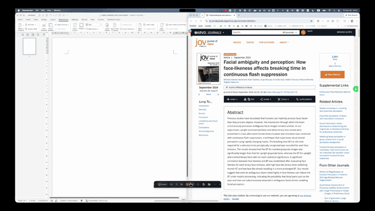

# DOI → Word 参考文献マクロ / DOI to Word References

DOI を貼り付けるだけで、Word の参考文献（資料文献）に論文を追加できるマクロです。
Windows と Mac の Word で使えます。

A Word macro that adds papers to Word's built-in references just from their DOI.
Works in Word for Windows and Mac. **English version below.**

デモ動画 / Demo: 

---

## 日本語

### できること

- DOI を入れると、著者・タイトル・雑誌名・年・巻・号・ページを自動で取得して、Word の「資料文献の管理」に追加します。
- 1件ずつ追加することも、テキストファイル（.txt / .csv）でまとめて追加することもできます。
- 同じ文献が2回入っていても、1つだけ追加します（重複はスキップ）。
- 進み具合を表示する進捗バーが出ます。
- おまけ：本文中の引用を青色にするマクロ。
- おまけ：APA 第7版スタイル（修正版）。

使える書き方の例：

| 種類 | 例 |
|---|---|
| DOI | `10.1068/p5129` / `doi:10.1068/p5129` |
| DOI のリンク | `https://doi.org/10.1068/p5129` |
| 出版社のページ（URL に DOI が入っているもの） | `https://onlinelibrary.wiley.com/doi/10.1111/desc.12498` |
| arXiv | `arXiv:1706.03762` / `https://arxiv.org/abs/1706.03762` |
| PubMed | `PMID: 32015507` / `PMC7092803` |

### ファイル

| ファイル | 内容 |
|---|---|
| `paper_template_with_macro.dotm` | **いちばん簡単。** マクロと進捗バーが全部入った Word テンプレート |
| `DoiToWord.bas` | 文献を追加するマクロ本体（自分の Word に入れたい人向け） |
| `ColorCitations.bas` | 本文中の引用を青色にするマクロ |
| `APASeventhEdition.xsl` | APA 第7版スタイル（修正版） |
| `dois.txt` | 試しに使える DOI のリスト |
| `demo.mp4` | 使い方の動画 |

### 必要なもの

- Microsoft Word（Windows または Mac）
- インターネット接続

### 使い方（テンプレートを使う方法・おすすめ）

**1. テンプレートを開く**

- **Windows**：ダウンロードした `paper_template_with_macro.dotm` を右クリック →「プロパティ」→ 下の方の「許可する」にチェック →「OK」。
  その後ダブルクリックで開き、上に出る黄色いバーの「コンテンツの有効化」をクリック。
  （「許可する」にチェックしないと、Windows がマクロを止めてしまいます。）
- **Mac**：`paper_template_with_macro.dotm` をダブルクリック →「マクロを有効にする」をクリック。

新しい文書が開きます。この文書で作業します。

**2. 文献を追加する**

1. マクロの画面を開きます。
   - Windows：「表示」タブ →「マクロ」
   - Mac：画面上のメニュー「ツール」→「マクロ」→「マクロ...」
2. `AddReferencesFromDOI` を選んで「実行」。
3. 質問が出ます。
   - **はい** → DOI を1つ入力
   - **いいえ** → DOI のリスト（.txt / .csv）を選ぶ（1行に1つ。試すなら `dois.txt`）
4. 終わると、追加できた数・スキップした数・失敗した数が表示されます。

**3. 本文に引用を入れる**

- 「参考資料」タブ →「引用文献の挿入」→ 文献を選ぶ。
- 文献リストは「参考資料」タブ →「文献目録」で入れます。
- スタイルは「参考資料」タブの「スタイル」で選びます（APA 第7版は下の「APA 第7版スタイルを入れる」を参照）。

### 使い方（自分の Word にマクロを入れる方法）

テンプレートを使わず、いつもの Word で使いたい場合：

1. Word で「Visual Basic Editor」を開きます。
   - Windows：`Alt` + `F11`
   - Mac：「ツール」→「マクロ」→「Visual Basic Editor」
2. 「ファイル」→「ファイルのインポート」→ `DoiToWord.bas` を選ぶ（青色マクロも使うなら `ColorCitations.bas` も）。
3. あとは上の「2. 文献を追加する」と同じです。

この方法では進捗バーの画面は入りません（進み具合は Word 下のステータスバーに出ます）。
進捗バーも使いたい場合は、`DoiToWord.bas` の先頭のコメントにある手順で `frmProgress` を作ってください。

### APA 第7版スタイルを入れる

Word の参考文献スタイルに APA 第7版を追加します。入れたら **Word を一度終了して開き直してください。**

- **Windows**：エクスプローラーのアドレス欄に `%APPDATA%\Microsoft\Bibliography\Style` と入力して Enter。開いたフォルダに `APASeventhEdition.xsl` をコピー。
- **Mac**：Finder で「アプリケーション」を開く →「Microsoft Word」を右クリック →「パッケージの内容を表示」→「Contents」→「Resources」→「Style」フォルダに `APASeventhEdition.xsl` をドラッグ（パスワードを聞かれたら入力）。
  ※ Word をアップデートすると消えることがあります。そのときはもう一度コピーしてください。

**元のスタイルからの変更点**：同じ第一著者の論文が複数あると、本文中の引用に論文タイトルが入ってしまう問題を直しました。
例：`(Otsuka et al., Development of Modal..., 2006)` → `(Otsuka et al., 2006)`

### 引用を青色にする（おまけ）

マクロ `ColorCitationsBlue` を実行すると、本文中の引用だけが青色（RGB 0, 112, 192）になります。
Word の引用に加えて、ReadCube / Papers の SmartCite で入れた引用にも使えます。
「引用文献と文献目録の更新」（SmartCite なら引用の更新）をすると黒に戻ることがあるので、そのときはもう一度実行してください。

### 知っておくと便利なこと

- **文献目録には、引用していない文献も全部出ます。** 使わない文献は「参考資料」→「資料文献の管理」で削除してください。
- **引用を消しても、文献は残ります。** 文献目録から消すには「資料文献の管理」でも削除します。
- **変更はすぐには反映されません。** 文献目録をクリックして「引用文献と文献目録の更新」を押してください。
- **同じ著者・同じ年の論文が2つある場合**、Word は 2004a / 2004b を自動で付けません。「資料文献の管理」→「編集」で年を `2004a` のように手で直してください。
- **追加に失敗したとき**：DOI が正しいか、インターネットにつながっているかを確認してください。
- 文献情報は doi.org と NCBI（PubMed）から取得します。個人情報は送信しません。
- Mac で動作確認しています。

### 謝辞

`APASeventhEdition.xsl` は Brian Kavanaugh さんの
[APA-7th-Edition](https://github.com/briankavanaugh/APA-7th-Edition/blob/main/APASeventhEdition.xsl)（MIT ライセンス）を一部修正したものです。

### ライセンス

[MIT ライセンス](LICENSE)。誰でも自由に使用・改変・再配布できます（商用も可）。
条件は、著作権表示とライセンス文を残すことだけです。

---

## English

### What it does

- Paste a DOI and it fetches the authors, title, journal, year, volume, issue and pages, then adds the paper to Word's **Manage Sources** list.
- Add one paper at a time, or many at once from a text file (.txt / .csv).
- Duplicates are skipped, so each paper is added only once.
- A progress bar shows how far along it is.
- Extra: a macro that colours in-text citations blue.
- Extra: an APA 7th edition style (fixed version).

Accepted formats:

| Type | Example |
|---|---|
| DOI | `10.1068/p5129` / `doi:10.1068/p5129` |
| DOI link | `https://doi.org/10.1068/p5129` |
| Publisher page (with the DOI in the URL) | `https://onlinelibrary.wiley.com/doi/10.1111/desc.12498` |
| arXiv | `arXiv:1706.03762` / `https://arxiv.org/abs/1706.03762` |
| PubMed | `PMID: 32015507` / `PMC7092803` |

### Files

| File | What it is |
|---|---|
| `paper_template_with_macro.dotm` | **Easiest.** A Word template with all macros and the progress bar built in |
| `DoiToWord.bas` | The main macro (to add it to your own Word) |
| `ColorCitations.bas` | Macro that colours in-text citations blue |
| `APASeventhEdition.xsl` | APA 7th edition style (fixed version) |
| `dois.txt` | Sample list of DOIs to try |
| `demo.mp4` | Demo video |

### What you need

- Microsoft Word (Windows or Mac)
- An internet connection

### How to use (with the template, recommended)

**1. Open the template**

- **Windows**: right-click the downloaded `paper_template_with_macro.dotm` → **Properties** → tick **Unblock** near the bottom → **OK**.
  Then double-click it and click **Enable Content** in the yellow bar.
  (Without "Unblock", Windows blocks the macros.)
- **Mac**: double-click `paper_template_with_macro.dotm` → click **Enable Macros**.

A new document opens. Work in this document.

**2. Add references**

1. Open the macro list.
   - Windows: **View** tab → **Macros**
   - Mac: menu bar **Tools** → **Macro** → **Macros...**
2. Select `AddReferencesFromDOI` and click **Run**.
3. A question appears.
   - **Yes** → type one DOI
   - **No** → choose a list of DOIs (.txt / .csv, one per line; try `dois.txt`)
4. When it finishes, it shows how many were added, skipped and failed.

**3. Cite them in your text**

- **References** tab → **Insert Citation** → pick the paper.
- Add the reference list with **References** tab → **Bibliography**.
- Choose the style under **Style** on the **References** tab (for APA 7th, see "Install the APA 7th style" below).

### How to use (add the macro to your own Word)

If you want it in your normal Word instead of the template:

1. Open the **Visual Basic Editor**.
   - Windows: `Alt` + `F11`
   - Mac: **Tools** → **Macro** → **Visual Basic Editor**
2. **File** → **Import File...** → choose `DoiToWord.bas` (and `ColorCitations.bas` for the blue citations).
3. Then follow "2. Add references" above.

This way there is no progress bar window; progress is shown in Word's status bar instead.
To get the progress bar too, create `frmProgress` as described in the comment at the top of `DoiToWord.bas`.

### Install the APA 7th style

This adds APA 7th edition to Word's citation styles. **Quit and reopen Word afterwards.**

- **Windows**: type `%APPDATA%\Microsoft\Bibliography\Style` into the File Explorer address bar and press Enter. Copy `APASeventhEdition.xsl` into that folder.
- **Mac**: in Finder, open **Applications** → right-click **Microsoft Word** → **Show Package Contents** → **Contents** → **Resources** → **Style**, and drag `APASeventhEdition.xsl` into it (enter your password if asked).
  Note: a Word update may remove it. If so, copy it in again.

**Change from the original style**: in-text citations no longer include the paper title when several papers share the same first author.
Example: `(Otsuka et al., Development of Modal..., 2006)` → `(Otsuka et al., 2006)`

### Blue citations (extra)

Run the macro `ColorCitationsBlue` to colour only the in-text citations blue (RGB 0, 112, 192).
It works for Word's own citations and for citations inserted with ReadCube / Papers SmartCite.
**Update Citations and Bibliography** (or a SmartCite refresh) may turn them black again; just run it again.

### Good to know

- **The bibliography lists every source in the document, cited or not.** Delete unused ones in **References** → **Manage Sources**.
- **Deleting a citation does not delete the source.** To remove it from the bibliography, also delete it in **Manage Sources**.
- **Changes don't show right away.** Click the bibliography and choose **Update Citations and Bibliography**.
- **Two papers by the same authors in the same year**: Word does not add 2004a / 2004b by itself. Change the year to `2004a` by hand in **Manage Sources** → **Edit**.
- **If a paper fails to add**: check that the DOI is correct and that you are online.
- Paper details come from doi.org and NCBI (PubMed). No personal information is sent.
- Tested on Word for Mac.

### Acknowledgements

`APASeventhEdition.xsl` is a modified version of
[APA-7th-Edition](https://github.com/briankavanaugh/APA-7th-Edition/blob/main/APASeventhEdition.xsl) by Brian Kavanaugh (MIT License).

### License

[MIT License](LICENSE). Anyone can use, change and share it freely, including for commercial use.
The only condition is to keep the copyright notice and license text.
